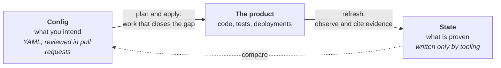

# Exacly

Keep a product model true to what ships, across the software development lifecycle.



Exacly describes a product from business purpose down to the systems that run it: outcomes, capabilities, processes, requirements, information, applications and infrastructure, and how they relate. Teams and agents author that description as **config**. Tooling observes the real system (builds, tests, deployments, metrics) and records what it finds as **state**, with the evidence behind it. Comparing the two shows what is planned, what has shipped, and where the model and the product have drifted apart.

The project has two parts:

- **The [Exacly Specification](spec/README.md)**, which defines the model, its traceability rules and its validation rules, with JSON Schemas for config and state.
- **Tools that follow the specification** through the lifecycle, so the model is checked and kept current as part of everyday development rather than written once and left to go stale.

## In one example

A team wants freelancers to get paid sooner, so the model says the reminder service must remind customers three days before an invoice is due. Here is that requirement and its links, cut down from the [invoice reminders example](spec/examples/0.2/invoice-reminders/billing.yaml):

```yaml
records:
  - id: REQ-001
    type: Requirement
    name: Remind before due date
    statement: >-
      Send one reminder three days before the due date if the invoice remains
      unpaid and the customer can receive email.
    observe:
      tests: { workflow: .github/workflows/ci.yml, cases: ["tests/reminders/*"] }
  # ... OUT-001, CAP-001, PROC-001, APP-001 and the rest

relationships:
  - { source: REQ-001, type: supports, target: PROC-001 }
  - { source: APP-001, type: implements, target: REQ-001 }
```

Anyone, or any agent, can now ask why the requirement exists:

```console
$ exacly trace REQ-001 -m spec/examples/0.2/invoice-reminders
Why
REQ-001 Requirement: Remind before due date (proposed)
  supports -> PROC-001 Process: Collect an invoice payment (proposed)
    uses_capability -> CAP-001 Capability: Collect payments (proposed)
      contributes_to -> OUT-001 Outcome: Faster invoice payment (proposed)
```

and what is still missing:

```console
$ exacly gaps -m spec/examples/0.2/invoice-reminders
Requirements not verified in any context (1)
  REQ-001 Requirement: Remind before due date (proposed)
```

Nothing has run yet, so nothing is proven. Once the test cases under `tests/reminders/` pass in that workflow, `exacly refresh` reads their results and records the run as evidence in state, and the gap closes without anyone editing the model. If the tests later fail, the next refresh records that, and the requirement is back on the list.

## How it fits the lifecycle

Exacly borrows the plan and apply loop from infrastructure as code, and the spec/status split from Kubernetes.

| Step | What it does | Status |
| --- | --- | --- |
| **Describe** | Author config in YAML: records, relationships, exceptions and how each record can be observed. Start from a description (greenfield) or from an existing repo and documents (brownfield). | Spec 0.2 |
| **Validate** | Check config against the schema, the relationship rules and the traceability rules. | [`exacly validate`](python/README.md#validate), 0.1 and 0.2 |
| **Refresh** | Observe the real system and write state: assessments per environment and the evidence behind them. | [`exacly refresh`](python/README.md#refresh), from test results; [`exacly observe manual-qa`](python/README.md#manual-verification), from manual checks people commit |
| **Ask** | Show a record, trace why it exists and what realizes it, list what a change affects and what the model is missing. | [`exacly`](python/README.md#questions) show, trace, impact and gaps; [views](python/README.md#views) as a pull request plan and a site; an [MCP server and skill](#with-coding-agents) for agents |
| **Plan** | Propose the next observation or investigation for each verification prerequisite in a policy, against an explicit implementation target. | [`exacly plan`](python/README.md#plan-verification-work), read-only verification proposals; delivery planning remains planned |
| **Apply** | Turn the plan into tasks for people or agents. The next refresh closes them. | Planned |

## Where it comes from

Exacly started from a gap in AI-assisted development. Agents now write code faster than anyone can keep a description of the product true to it. Spec-driven tools treat the spec as a prompt that goes stale once the code is written, and architecture tools draw what exists without saying what was intended or proven. [Our research](docs/uml-spec-driven-development-research.md) found tools for each step of the loop from model to code and back, but none that checks code against the intended model, so that return path is where Exacly starts.

Its ideas come from established practice:

- **[ArchiMate](https://archimate-community.pages.opengroup.org/workgroups/archimate-101/)** informs the record types and relationships, from outcomes and capabilities down to infrastructure. Exacly keeps its own vocabulary and does not claim ArchiMate conformance.
- **[UML](https://www.omg.org/uml/what-is-uml.htm)** fits the detailed views of structure and behaviour, such as interactions, workflows and state transitions.
- **Terraform** gives the loop: authored config, recorded state, and plan and apply to bring them together.
- **Kubernetes** gives the split between what was asked for and what was observed, as spec and status do, with status written only by tooling.
- **Supply chain attestations** such as in-toto and OpenVEX shape evidence: state cites a test run or deployment record rather than copying it, and a negative assessment must give its reason.
- **[OpenAPI](https://spec.openapis.org/oas/)** gives the versioning: semantic spec versions with dated schema iterations.

## Repository layout

| Path | Contents |
| --- | --- |
| [`spec/`](spec/README.md) | Specification versions, JSON Schemas, worked examples and data-driven test cases |
| [`python/`](python/README.md) | `exacly`, the command and Python package: validate, refresh, questions, verification plans, views and the MCP server |
| [`skills/`](skills/exacly/SKILL.md) | The skill that tells coding agents how to work with a model |
| [`docs/`](docs/) | Research and pilot notes |
| [`docs/site/`](docs/site/README.md) | Static landing-page mockup, worked model example, and GitHub Pages instructions |

## Quick start

Validate the [invoice reminders example](spec/examples/0.2/invoice-reminders/), a small slice of a product written as 0.2 config:

```sh
uv tool install exacly
exacly validate spec/examples/0.2/invoice-reminders
```

In your own project, keep config in `spec/exacly/` and pass the commit it was validated at with `--revision "$(git rev-parse HEAD)"`.

## With coding agents

`exacly mcp` runs an [MCP](https://modelcontextprotocol.io) server on stdio, so a coding agent can look up records, trace why they exist, and check what a change affects while it works. To add it in Claude Code, from the repository that holds the model:

```sh
claude mcp add exacly -- uvx exacly mcp
```

Copy the [`exacly` skill](skills/exacly/SKILL.md) to `.claude/skills/exacly/` too: it tells the agent when to ask the model and how to keep config true to a change. [The MCP server](python/README.md#mcp-server) lists its tools.

## In CI

Other repositories run Exacly with the [Exacly action](https://github.com/whiteredhouse/exacly-action): `check` validates the model and fails the job when it doesn't conform, and `plan` comments the change plan on each pull request.

```yaml
- uses: whiteredhouse/exacly-action@v0
  with:
    model: spec/exacly
```

Its README has the full workflow and inputs.

## Development

The repository uses [mise](https://mise.jdx.dev/) for Python, uv and tasks. Run what CI runs (tests, Ruff, mypy and every example) with:

```sh
mise run check
```

The check also evaluates [`ci/verification.yaml`](ci/verification.yaml) against a target for the checked commit. It requires verification of every active Requirement, independently of delivery. The model binds stable test-case IDs rather than a workflow name, so both the Spec and Release workflows can supply those results. Results and the selected target are written under `reports/`. See [release notes](CHANGELOG.md) for package changes.

## Status

Browse [Exacly's own model and recorded state](https://whiteredhouse.github.io/exacly/project/). CI updates this view after successful checks on `main`. The [raw state](spec/exacly/state/main.json) retains each observation’s revision and time.

Exacly is at 0.x and unstable: anything may change until 1.0, which comes with the first outside adopter. See [Versioning](spec/README.md#versioning).

Each part of Exacly has its own version, tagged as `<part>-vX.Y.Z`, as release-please and Changesets tag the parts of one repository:

- **The specification**, `spec-vX.Y.Z`: the file in [`spec/versions/`](spec/versions/) and the `exacly:` line of every model document.
- **The Python package**, `python-vX.Y.Z`: the `exacly` package and command, with validation, refresh, questions, views and the MCP server. Up to 0.1.0 it was `exacly-validate`, tagged `validator-vX.Y.Z`. Pushing a `python-v` tag publishes that version to [PyPI](https://pypi.org/project/exacly/), once the tag matches the version in `pyproject.toml`.
- **The GitHub Action** lives in [whiteredhouse/exacly-action](https://github.com/whiteredhouse/exacly-action), tagged `vX.Y.Z` with a moving `v0`, as workflows expect. Each action release runs one package release.

| Package | Spec versions it reads |
| --- | --- |
| 0.1.0 (`exacly-validate`) | 0.1, 0.2 |
| 0.2.0 | 0.1, 0.2 |
| 0.2.1, the first on [PyPI](https://pypi.org/project/exacly/) | 0.1, 0.2 |
| 0.3.0: assessment sources, combined results, lists of bindings, the manual-qa extension | 0.1, 0.2 |
| 0.4.0: independent verification, explicit assessment targets and readiness policies | 0.1, 0.2 |
| 0.5.0: incomplete execution of case-bound tests gives inconclusive verification | 0.1, 0.2 |
