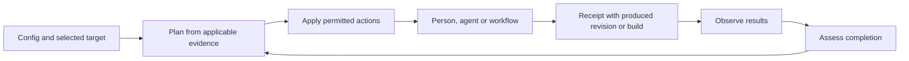

# Automated plan and apply for Exacly

Research date: 28 October 2026

Status: Research and proposed implementation design

Exacly should own the loop from product intent to observable completion, with coding agents and existing workflows acting as executors. The first useful `apply` should dispatch traceable work, resume safely, and close that work when matching evidence arrives.

Scope: automated planning, work dispatch and completion reconciliation for [Exacly](https://github.com/whiteredhouse/exacly) and the [Exacly Action](https://github.com/whiteredhouse/exacly-action). The implementation baseline is Exacly commit [`ce63d80`](https://github.com/whiteredhouse/exacly/commit/ce63d80e30d8c8abd7ebbcd7a9ff83b6f09ca4c0), package 0.5.0, and Action commit [`6db530d`](https://github.com/whiteredhouse/exacly-action/commit/6db530d041d51c030b89a64eaea8bc88cbfd87a8), whose package metadata is 0.6.0 and pins `exacly==0.5.0`.

## Current implementation

The existing code provides much of the foundation:

| Capability | Current behavior | What automated plan and apply needs |
| --- | --- | --- |
| Plan | `exacly view plan` compares authored models and renders a PR comment with affected records and tests to recheck. | A saved, machine-readable work plan with explicit actions and completion conditions. |
| Assess and gate | Evaluate observations against a selected implementation target and readiness policy. | Reuse these semantics to determine whether work achieved its intended result. |
| Pending work | State can record a record ID, task identifier, opening time and dimension. | Dispatch tracking, retries and observation-based completion. |
| GitHub Action | Supports `check`, `plan` and `gate`. | An execution contract and durable receipts before adding `apply`. |

Sources: [plan implementation](https://github.com/whiteredhouse/exacly/blob/ce63d80e30d8c8abd7ebbcd7a9ff83b6f09ca4c0/python/src/exacly/views.py#L55), [target assessment](https://github.com/whiteredhouse/exacly/blob/ce63d80e30d8c8abd7ebbcd7a9ff83b6f09ca4c0/python/src/exacly/query.py#L505), [pending-work schema](https://github.com/whiteredhouse/exacly/blob/ce63d80e30d8c8abd7ebbcd7a9ff83b6f09ca4c0/spec/schema/0.2/state/2026-10-26.json#L432), [Action inputs](https://github.com/whiteredhouse/exacly-action/blob/6db530d041d51c030b89a64eaea8bc88cbfd87a8/action.yml#L10) and [Action package metadata](https://github.com/whiteredhouse/exacly-action/blob/6db530d041d51c030b89a64eaea8bc88cbfd87a8/pyproject.toml).

A CLI check reproduced the practical distinction on the unchanged invoice-reminders example:

```sh
exacly view plan --base HEAD -m spec/examples/0.2/invoice-reminders
exacly gaps -m spec/examples/0.2/invoice-reminders
```

The plan reports no model changes and a conforming model. Gaps still reports an unverified and unreleased requirement. A model diff therefore cannot serve as the reconciliation planner.

The most consequential missing behavior is task completion. Refresh currently preserves pending work while its record exists; it does not close tasks when new observations satisfy them. The specification already requires observation-confirmed completion. This needs an explicit reconciler. [Refresh implementation](https://github.com/whiteredhouse/exacly/blob/ce63d80e30d8c8abd7ebbcd7a9ff83b6f09ca4c0/python/src/exacly/refresh.py#L284), [specification section 9](https://github.com/whiteredhouse/exacly/blob/ce63d80e30d8c8abd7ebbcd7a9ff83b6f09ca4c0/spec/versions/0.2.0.md#L205).

## Proposed workflow



Planning should classify the gap before commissioning work. Missing evidence cannot establish that implementation is missing.

| Finding | Appropriate proposed action |
| --- | --- |
| No observation binding | Configure observation or request an owner decision. |
| Binding exists, but no applicable result | Collect evidence or rerun the mapped workflow. |
| Test pattern selects nothing | Repair or review the binding. |
| Applicable verification failed | Investigate and propose a repair. |
| Approved behavior requires implementation | Create implementation work with the relevant criteria. |
| Delivery evidence is missing | Inspect deployment status or request delivery through a configured workflow. |
| Measurement window remains open | Wait until the declared evaluation time. |

Use target-specific `assess` results as the foundation. Current `gaps` summarizes coverage across contexts; a pass somewhere cannot answer whether the selected production build satisfies a requirement. [Coverage implementation](https://github.com/whiteredhouse/exacly/blob/ce63d80e30d8c8abd7ebbcd7a9ff83b6f09ca4c0/python/src/exacly/query.py#L351).

Begin with Requirement verification and delivery, which the current readiness machinery supports. Operation and outcome evaluation can follow as their observers and policies mature. The planner can classify established findings deterministically; implementation design and ambiguous product decisions can be delegated to a person or agent while preserving the approved criteria. [Readiness policy implementation](https://github.com/whiteredhouse/exacly/blob/ce63d80e30d8c8abd7ebbcd7a9ff83b6f09ca4c0/python/src/exacly/policy.py).

## Saved plans and execution receipts

A saved plan should be the execution contract. It should contain:

- A schema version, plan digest and tool version.
- Model namespace, immutable revisions and content digests.
- The diagnostic implementation target, including relevant builds and scope.
- State lineage, serial and digest; policy identity and digest; evaluation time.
- Stable action IDs, affected records, reasons, dependencies and permitted executor.
- Explicit preconditions and observable completion conditions.

Render the review comment from this same object. Applying a reviewed plan should execute its declared scope; changed preconditions should produce a new plan or an explicit supersession. Terraform's saved-plan workflow provides a useful precedent for this separation. [Terraform apply](https://developer.hashicorp.com/terraform/cli/commands/apply).

Apply needs a durable execution ledger alongside observed state. Each receipt should identify the plan and action, attempts, external task or PR, executor, output revision or build, and eventual completion evidence.

This addresses the difficult failure cases: a process crashes after creating an issue, a retry begins, or two workers dispatch the same action. Persist dispatch intent, give external work a stable action marker, recover existing work before retrying, and serialize conflicting dispatches. Receipts deserve durable storage because observations alone cannot reconstruct execution history.

A changing state serial should trigger re-evaluation. If newer evidence already satisfies the goal, supersede the action without dispatching it. State has a stable lineage and increasing serial, and conflicting state versions are resolved by observing again. Apply must preserve observers' ownership of assessments. [Specification section 9](https://github.com/whiteredhouse/exacly/blob/ce63d80e30d8c8abd7ebbcd7a9ff83b6f09ca4c0/spec/versions/0.2.0.md#L199), [source replacement](https://github.com/whiteredhouse/exacly/blob/ce63d80e30d8c8abd7ebbcd7a9ff83b6f09ca4c0/python/src/exacly/refresh.py#L290).

## Implementation identity and completion

Input and output implementation identities must remain distinct. A repair planned against revision A produces revision B. Completion must assess B against the approved criteria. Requiring B's evidence to match A would prevent completion; relabeling A's evidence as B would create a false claim. Exacly already distinguishes model revision from implementation revision and build composition. [Applicability rules](https://github.com/whiteredhouse/exacly/blob/ce63d80e30d8c8abd7ebbcd7a9ff83b6f09ca4c0/python/src/exacly/applicability.py#L15).

### Observer identity prerequisite

The model can represent separate identities, but general `refresh` currently cannot supply them independently. Its CLI accepts one `--revision`, and `Run` carries one revision. Test and distribution observations write that value as both `subject.model_revision` and `subject.revision`. [CLI input](https://github.com/whiteredhouse/exacly/blob/ce63d80e30d8c8abd7ebbcd7a9ff83b6f09ca4c0/python/src/exacly/cli.py#L219), [test subject](https://github.com/whiteredhouse/exacly/blob/ce63d80e30d8c8abd7ebbcd7a9ff83b6f09ca4c0/python/src/exacly/refresh.py#L105), [distribution subject](https://github.com/whiteredhouse/exacly/blob/ce63d80e30d8c8abd7ebbcd7a9ff83b6f09ca4c0/python/src/exacly/refresh.py#L184).

Before automatic completion, extend that observer contract to identify the approved model and produced implementation separately. Alternatively, explicitly select both at the produced revision through a successor plan that revalidates the approved criteria and bindings. Do not silently change earlier observations' subjects or assume equal config content makes different revisions interchangeable to the current matcher.

Keep these facts separate:

- The executor finished.
- A PR merged.
- Verification passed for the resulting implementation.
- Delivery occurred in the selected environment.

An unknown readiness result can justify collecting evidence or repairing behavior. Authorization to perform that remedial action is a separate policy decision from readiness to release.

Changed acceptance criteria or observation bindings require review and replanning before an executor can claim completion against them. A generated passing test establishes only the claim its binding and evidence support; it does not automatically establish complete acceptance coverage. Verification and delivery remain independent. [Specification section 8](https://github.com/whiteredhouse/exacly/blob/ce63d80e30d8c8abd7ebbcd7a9ff83b6f09ca4c0/spec/versions/0.2.0.md#L152).

### Trusted evidence admission prerequisite

Current `gate` evaluates supplied state and evidence metadata. Applicability checks match the selected subject and bindings; `core.supported` checks evidence kind, applicability and expiry. These checks do not authenticate the report producer, fetch the referenced CI result or verify its digest or signature. Refresh consumes supplied JUnit and caller-provided run metadata. Matching identities alone therefore cannot prevent fabricated completion evidence. [Assessment](https://github.com/whiteredhouse/exacly/blob/ce63d80e30d8c8abd7ebbcd7a9ff83b6f09ca4c0/python/src/exacly/query.py#L505), [evidence checks](https://github.com/whiteredhouse/exacly/blob/ce63d80e30d8c8abd7ebbcd7a9ff83b6f09ca4c0/python/src/exacly/core.py#L518), [report input](https://github.com/whiteredhouse/exacly/blob/ce63d80e30d8c8abd7ebbcd7a9ff83b6f09ca4c0/python/src/exacly/cli.py#L236).

Automatic closure needs a trusted observation and admission path around this evaluator. Protect the authoritative workflow, criteria, bindings and policy; establish which producer ran the checks against which implementation; retain identified reports; and reject executor-authored state as completion evidence. A trusted runner can still execute weakened tests, so retain and review changes to test meaning and coverage. Evidence origin, target applicability and acceptance coverage are separate checks. This is a proposed automation prerequisite, not behavior already provided by `gate`.

## Existing approaches and integration choices

The external research supports building Exacly's reconciliation core while integrating existing execution tools:

| Precedent | Relevant behavior | Implication for Exacly |
| --- | --- | --- |
| [Kubernetes controllers](https://kubernetes.io/docs/concepts/architecture/controller/) | Controllers can request changes through other components. | Exacly can coordinate work while executors retain responsibility for coding and deployment. |
| [Argo CD automated sync](https://argo-cd.readthedocs.io/en/stable/user-guide/auto_sync/) | Separates automatic sync, retries, self-healing and pruning; deduplicates using revision and parameters. | Give dispatch, retries, merging, deployment and retirement separate policies. |
| [Spec Kit](https://github.com/github/spec-kit/blob/main/docs/quickstart.md) | Documents a convergence loop that checks implementation and appends remediation tasks. | Integrate it as an executor; avoid positioning Exacly around uniquely having a return loop. |
| [OpenSpec](https://github.com/Fission-AI/OpenSpec/blob/main/docs/workflows.md) | Supports implementation and verification workflows; verification is optional in its documented workflow. | Treat workflow completion as progress, then assess Exacly's required evidence. |
| [Kiro](https://kiro.dev/docs/specs/) | Supports requirements, design, task execution and correctness testing. | Reuse execution capabilities while retaining target-specific evidence and policy decisions. |

This updates the competitive picture in the [earlier landscape research](uml-spec-driven-development-research.md). Exacly's strongest opportunity is connecting product intent, implementation identity, applicable evidence and observable completion across executors. These documented workflows alone do not establish that competing products cannot support similar integrations.

An executor adapter should receive requirement IDs, approved criteria and binding fingerprints, the input implementation, dependencies and expected observations. It should return task or PR references, produced revision or build identities, and execution outcome. Exacly then observes and assesses that resulting target.

## Delivery sequence

1. **Target-aware planning.** Add a versioned plan format, deterministic gap classification and Markdown rendering. Preserve the existing PR impact view.
2. **Task dispatch.** Add dry-run support, a durable receipt ledger and one GitHub task adapter with duplicate prevention and crash recovery.
3. **Completion reconciliation.** Establish separate observer identities and trusted evidence admission before automatic closure. Reuse applicability and policy evaluation to close pending work from observations of the resulting implementation. Preserve unrelated observers' assessments.
4. **Bounded agent execution.** Add one executor adapter returning PR and output revision identities, then introduce retry budgets and explicit policies for further automation.

Keep plan, policy, target and receipt files outside the recursively loaded model directory. For GitHub execution, privileged dispatch should use trusted workflow code; fork-produced artifacts remain untrusted inputs. [Exacly target guidance](https://github.com/whiteredhouse/exacly/blob/ce63d80e30d8c8abd7ebbcd7a9ff83b6f09ca4c0/python/README.md#assess-an-implementation-target), [GitHub workflow security guidance](https://docs.github.com/en/actions/reference/security/securely-using-pull_request_target).

## Pilot acceptance cases

The first pilot should demonstrate these cases:

- Repeated apply and crash recovery create one external task.
- Changed criteria, bindings, policy or target prevent stale dispatch.
- Agent completion reports, issue closure and PR merge leave work pending without sufficient evidence.
- Wrong-build, wrong-environment, expired or incomplete results cannot close work.
- New output revisions can satisfy the approved completion condition.
- Observations identify the approved model revision and produced implementation independently, without relabeling historical evidence.
- Fabricated reports or executor-authored state cannot close work even when their supplied identity metadata matches the target.
- Weakened tests or removed checks cannot establish completion without review of their acceptance coverage.
- Partial failure preserves successful receipts and retries remaining work.
- Refreshing one source preserves unrelated assessments; a requirement bound to tests and manual QA remains unverified until both required sources pass.
- Concurrent applies serialize conflicting dispatches and state writes.
- Retiring a model record explicitly supersedes work while preserving history; retirement alone does not authorize destruction of implementation.

Measure duplicate dispatches, false completions, manual interventions and time to applicable evidence.

## Research validation

The CLI behavior check above ran against the recorded baseline. Applicability, policy and refresh tests passed all 113 cases. The Action suite passed 29 of 30 tests; the fresh-install test was blocked by a package-download connection failure. These checks describe the existing implementations, rather than validation of the proposed plan and apply design.
