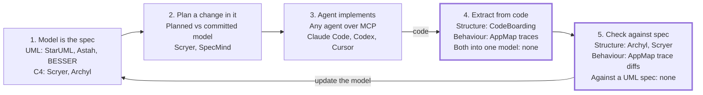

# Developing from UML specifications: landscape and opportunity

Research date: 9 October 2026

No product with real traction lets a developer work from a UML-style model end to end today. That means structure and behaviour views as the editable spec, AI agents implementing changes to it, and the model rebuilt from code so the developer sees what changed. The pieces exist in separate tools, and the open part is the return path from code back to the model.

Scope: research for the product idea in the "Living system model" concept spec. This report covers existing products, the evidence, and where a new product would fit.

- **Classic UML tools** generate code skeletons, not behaviour. Since July 2025 several have shipped an MCP server, a connector that lets a coding agent read or edit the model. "UML model in, agent-written code out" already costs a $129 licence.
- **AI spec-driven tools** such as Spec Kit, Kiro and OpenSpec use Markdown specs. Diagrams are a by-product, and none checks code against the spec continuously.
- **The evidence** supports precise, typed design information as agent input. It does not support a UML class diagram on its own, which added almost nothing in the one controlled test.
- **Demand** for understanding agent changes is well measured. Demand for UML by name is weak: launches framed as UML or model-driven scored single digits on Hacker News, and a design canvas that avoids the word scored 424.
- **My recommendation** is a conformance layer that plugs into existing agents, with UML as the view and not the brand. Details are under Recommendation.

## Who covers which part of the loop

Every stage of the loop has at least one tool, but the two return stages are covered for structure or for behaviour, never both.

The forward path (stages 1 to 3) is covered; the return path (stages 4 and 5, thick border) is the open part. It is covered for structure or for behaviour, never both in one model.

Stages 1 to 3 can be assembled today from existing tools. No tool extracts both views into the model the developer specs from and then checks the code against it. The next table links each product.

## Closest products

Scryer runs the same loop as your idea for structure only, and Whiteboard has the traction on the review side without a model. Rows are ordered by closeness to the idea.

| Product | What it does | Views and how the model is built | What is missing |
| --- | --- | --- | --- |
| [Scryer](https://github.com/aklos/scryer) | Desktop app that keeps a committed model and a planned model. The difference is the work an agent implements over MCP. Drift detection uses no LLM. Alpha, one developer, 113 stars. | C4-style structure only; its README says it "isn't UML". Built from a tree-sitter import graph plus agent reconciliation. Python fully supported. | Behaviour views, a hosted service, and traction: its Show HN in March 2026 scored 3 points. |
| [Whiteboard](https://github.com/devdotfast/whiteboard) (YC W26) | Open-source canvas where agents draw their own work as sequence, flow and entity diagrams linked to code, beside an AST-aware diff. 2.2k stars. | Behaviour and data diagrams, drawn by the agent for each review. No persistent model. | A model that acts as the spec, and deterministic extraction. A C4-style "software map" and a plan mode are experimental. |
| [Archyl](https://www.archyl.com/) | SaaS that builds a C4 model from a repository. Agents plan against it over MCP, a Claude Code hook blocks writes that break conformance rules, and model changes arrive as change requests for a person to merge. | C4 structure, built by AI discovery. | Behaviour views. The hook works in Claude Code only and lets edits through when it cannot reach the service. |
| [SpecMind](https://github.com/specmind/specmind) | Three agent commands: analyse the code into a system file, design a feature as component and sequence diagrams, then implement it and update the system file. 50 stars. | Structure and sequences as Mermaid inside Markdown, from tree-sitter plus an LLM. Python supported. | Deterministic checking. Code-alignment validation and architecture diff are on its roadmap, not built. |
| [BESSER](https://github.com/BESSER-PEARL/BESSER) | Python low-code platform from the Luxembourg Institute of Science and Technology. A validated UML-like model feeds deterministic generators for SQLAlchemy, Django and other targets. Agent skills arrived in July 2026. 190 stars. | Class and state machine models, written by hand or by an agent. | Agent-written implementation, and extraction from existing code. Its generators replace the agent. |
| [AI-DLC-UML](https://github.com/takaakit/ai-dlc-uml) | Agent workflow that writes the design as UML models in Astah Pro through an MCP plugin, implements it, then runs a design-code sync step. 8 stars. | Full UML in a commercial desktop tool, written and synced by the agent. | Deterministic extraction, a diff view, and independence from Astah. |
| [CodeViz](https://www.codeviz.ai/) (YC S24) | Collaborative architecture diagrams built from the codebase and linked to source. Teams can branch the model for proposed designs and view pull requests visually. Pro costs $19 a month. | C4 and UML structure, built by an AI agent. | An agent that implements the branched design, and behaviour views. |
| [Intent](https://intentapp.dev/) (Augment Code) | Desktop app in public beta. A coordinator agent writes a spec per task, and agents draw architecture maps, sequence diagrams and state machines before they start. | Structure and behaviour, as agent drawings. | A persistent model extracted from code. |
| [Kiro](https://kiro.dev/docs/specs/) (AWS) | Spec-driven IDE. Each spec has requirements, design and task files, and the design file includes sequence diagrams. $20 to $200 per user per month. | Sequence diagrams inside Markdown, written by the agent. | Its docs describe no mechanism that keeps the spec in step with the code. |
| [StarUML 7](https://staruml.io/blog/posts/staruml-7-0-0-official-release/) | UML editor with an MCP server since July 2025. Claude or Cursor can create diagrams in it and generate code from them. | Full UML, drawn by hand or by an agent. | Any path back from code, and any conformance check. |
| [AppMap](https://appmap.io/) | Records runtime traces, shows them as sequence diagrams, and compares new traces with a baseline before merge. Agents can query the traces. | Behaviour, from deterministic recording. | A structure model, and a forward direction. |
| [CodeBoarding](https://github.com/CodeBoarding/CodeBoarding) | Component diagrams from static analysis. A review mode groups a change by component. 2.5k stars. | Structure, from static analysis with an LLM naming the components. Python supported. | Behaviour views, and a forward direction. |

[StartWithUML](https://startwithuml.cloud/) describes itself as a PlantUML platform that keeps architecture as a single source of truth and connects coding agents through MCP. I could read only its page metadata, so it is unassessed.

## The four groups of existing tools

Existing tools fall into four groups, and none of them treats a model as a spec that code is checked against.

| Group | Examples | How the spec or model is treated | What it tells you |
| --- | --- | --- | --- |
| Classic UML tools | [Sparx Enterprise Architect](https://sparxsystems.com/products/ea/17.2/history.html), [Visual Paradigm](https://www.visual-paradigm.com/shop/pricelist.jsp), [StarUML](https://staruml.io/buy), [Astah](https://astah.net/release-notes/pro-11-0/), [IBM Rhapsody](https://www.ibm.com/new/announcements/ibm-engineering-rhapsody-10-0-3-faster-enterprise-mbse-for-large-models-and-distributed-teams) | The model generates class skeletons. Behaviour is generated only from state machines, and only in some tools. | Their AI move is an MCP server, not a new generator. Python output is skeleton-only where it exists. |
| AI spec-driven tools | [Spec Kit](https://github.com/github/spec-kit) (139k stars), [Kiro](https://kiro.dev/docs/specs/), [OpenSpec](https://github.com/Fission-AI/OpenSpec) (66.9k), [BMAD Method](https://github.com/bmad-code-org/BMAD-METHOD) (53.9k), [Tessl](https://tessl.io/pricing) | Markdown requirements, plans and task lists. Diagrams are optional and unchecked. | Writing a spec before code is mainstream. Review burden and drift are the standing complaints. |
| Model-led agent tools | Scryer, Archyl, SpecMind, BESSER (linked above) | A model leads, and agents or generators follow. | All are small, structure-only or research-funded. |
| Code-to-diagram tools and agent canvases | [Archify](https://github.com/tt-a1i/archify) (78.9k stars), [Understand-Anything](https://github.com/Lum1104/Understand-Anything) (85.7k), [Windsurf Codemaps](https://cognition.com/blog/codemaps), [Cursor Canvas](https://cursor.com/en/blog/canvas) | An agent draws a picture on request. | Free and commoditised. The pictures are snapshots, not a model anyone specs from. |

**Classic UML tools**

- StarUML (July 2025), Astah (December 2025) and IBM Rhapsody (March 2026, read-only preview) each shipped an MCP server. Sparx's Japanese affiliate offers a [free one](https://www.sparxsystems.jp/en/MCP/) for Enterprise Architect with opt-in write access.
- Rhapsody, Cameo and Altova UModel generate no Python. Sparx, Visual Paradigm and StarUML generate Python skeletons.
- Prices are low. StarUML costs $129 once, and Sparx Enterprise Architect $245 to $750 per licence.

**AI spec-driven tools**

- I found no tool that documents a continuous check of code against its spec. Kiro's own docs describe none.
- The review burden is the loudest complaint. Birgitta Böckeler of Thoughtworks [wrote](https://martinfowler.com/articles/exploring-gen-ai/sdd-3-tools.html): "I'd rather review code than all these markdown files."
- François Zaninotto [counted](https://marmelab.com/blog/2025/11/12/spec-driven-development-waterfall-strikes-back.html) 8 files and 1,300 lines of text for a feature that displays a date. He also saw an agent mark testing as done without writing tests.
- Tessl [raised $125M](https://techcrunch.com/2024/11/14/tessl-raises-125m-at-at-500m-valuation-to-build-ai-that-writes-and-maintains-code/) in 2024 for spec-centred development. Its pricing page now sells agent skills, evals and reviews, and does not mention specs.

**Agent canvases from the big platforms**

- Cognition's Codemaps (November 2025) are AI-annotated maps of code that agents can read. Cognition says it is defining an open codemap protocol for other agents.
- Cursor Canvas (April 2026) lets agents build durable visual pages, including an interactive architecture diagram of a repository and grouped pull-request reviews.
- Neither post describes a persistent model with model-level diffs or a path from model to code.

## What the evidence says

Studies support giving agents precise, typed design information, but not a UML diagram on its own. No study yet tests whether model-level views help people follow agent changes.

**Does a model help the agent?**

- **Typed structure helps a lot.** Microsoft's [Repository Planning Graph](https://arxiv.org/abs/2509.16198) holds capabilities, files, data flows and function signatures. Building whole repositories from it reached 81.5% feature coverage and 69.7% test accuracy, about 27 and 36 points above Claude Code alone.
- **A class diagram alone does not.** [DesBench](https://arxiv.org/abs/2602.13611) tested 7 models on 30 Java projects. Pass@1 was 0.00 from requirements, at most 0.03 with a PlantUML class diagram added, and up to 0.54 with a code skeleton. The models were older and smaller than today's strongest.
- **For strong models, having the information matters more than its format.** A [Siemens study](https://arxiv.org/html/2608.21747v1) gave six models one architecture in five formats. Claude Sonnet 4.6 varied by 0.17 points out of 10 across formats, and rose from 5.08 to 8.42 when given any architecture guidance. A weaker model built 33% of the routes from prose and 100% from typed contracts.
- **A model can beat code as input.** [Calamo and colleagues](https://arxiv.org/html/2609.35281) had agents rebuild 8 applications. Tests passed 96.3% of the time from UML conceptual models and 65.8% from legacy code. Failures clustered in association multiplicities and state transitions.
- **A design step can hurt.** In [Paper2Code](https://arxiv.org/html/2504.17192v3), adding class and sequence diagrams lowered the score from 3.40 to 3.13. Adding file dependencies and build order raised it to 3.60.

**Can the model be rebuilt from code?**

- [RPG-Encoder](https://arxiv.org/abs/2602.02084) rebuilds the planning graph from existing code with 98.5% reconstruction coverage. Incremental updates cut maintenance cost by 95.7%.
- LLM-drawn UML covers little of a large codebase. [Code2UML](https://arxiv.org/abs/2605.24453) ran Claude Sonnet 4.6 agents over 12 repositories. Relationship precision was 0.858 and entity recall 0.313, which the authors call a deliberate focus on significant elements.
- Agents erode structure as they iterate. In [SlopCodeBench](https://arxiv.org/abs/2603.24755), complexity concentrated in 77% of agent runs. Quality instructions improved the starting point but not the rate of decline.

**Does a model view help the person?**

- Older experiments say design-level diagrams help. [Scanniello and colleagues](https://link.springer.com/article/10.1007/s10664-017-9591-4) pooled 12 experiments: UML design models improved code comprehension, and domain-level models did not.
- I found no study that compares UML-level views of AI-made changes with reading diffs. This is the central unproven assumption of the idea.

The machine-readable spec should therefore carry signatures, dependencies and state machines. UML is the right way to show that spec to a person, not the thing the agent needs.

## Why model-driven development stalled, and what has changed

Model-driven development failed on drift and on the cost of specifying behaviour, and AI removes only part of that.

**Why it stalled**

- **Drift.** Tools could generate code or reverse it, but not keep both in step. Developers told [Hillel Wayne](https://buttondown.com/hillelwayne/archive/why-uml-really-died/) that diagrams "rotted too quickly to be useful".
- **No gain in abstraction.** [Martin Fowler](https://martinfowler.com/bliki/ModelDrivenArchitecture.html) argued in 2004 that drawing behaviour as diagrams is no faster than writing it as code.
- **Models that could not be diffed.** UML had no usable text format, so a model could not be edited, searched or merged like code.
- **Low real use.** In Marian Petre's [2013 study](https://oro.open.ac.uk/35805/), 35 of 50 developers used no UML and none used it wholeheartedly. A [2025 study](https://www.inf.usi.ch/phd/raglianti/publications/Romeo2025a.pdf) found UML files in 4.2% of 13,152 GitHub projects.

**What has changed**

- An LLM removes the cost of building code generators and of drawing the first model.
- Text formats such as Mermaid and PlantUML live in git beside the code. The 2025 study found PlantUML the most used UML tool in open source since 2016.
- An agent can do the tedious half of keeping model and code in step.

**What has not**

- Böckeler warns that treating the spec as the source may combine the rigidity of model-driven development with the non-determinism of LLMs.
- Behaviour is still expensive to specify completely. A model that tries to say everything becomes a second codebase.
- Generating production code from models does work in certified fields such as avionics, as a [NASA guidebook](https://ntrs.nasa.gov/api/citations/20200012040/downloads/20200012040_Update.pdf) describes. Those fields use narrow languages and deterministic generators, which is the opposite of general UML fed to an LLM.

## Demand

The need to keep up with agent-made changes is well measured. A wish for UML itself is not.

**The pain**

- [Stack Overflow's 2026 survey](https://stackoverflow.blog/2026/10/06/the-results-of-the-2026-developer-survey-are-here/) had more than 30,000 respondents. Of those who use AI coding tools, 73% use them daily, and [48% trust AI](https://survey.stackoverflow.co/2026/ai) only when the answer is easy to validate.
- [Faros](https://www.faros.ai/blog/ai-acceleration-whiplash-takeaways), a vendor, compared periods of low and high AI adoption across 22,000 developers. Median time in review rose 441.5%, and pull requests merged with no review rose 31.3%.
- The Thoughtworks Radar of April 2026 lists [codebase cognitive debt](https://www.thoughtworks.com/en-us/radar/techniques/codebase-cognitive-debt) at Caution and [architecture drift reduction with LLMs](https://www.thoughtworks.com/radar/techniques/architecture-drift-reduction-with-llms) at Assess. Its remedies are automated architecture checks, not diagrams.
- Thoughtworks CTO Rachel Laycock [wrote](https://martinfowler.com/rachels-ramblings/code-review.html) in September 2026: "We need engineers to understand systems, not diffs."

**What developers do today**

- They hand agents diagrams as context, almost always as Mermaid inside Markdown. Kiro builds this into its design file.
- Agent-drawn diagrams contain errors. Nick Tune had Claude Code map flows across repositories and [reported](https://oreillyradar.substack.com/p/reverse-engineering-your-software) "significant inaccuracies that I had to spot and correct". He asks for tooling that exposes a system as a dependency graph agents can consult.
- The standard objection in the [Whiteboard thread](https://news.ycombinator.com/item?id=49833867) is that a diagram is one more thing that drifts from the code.

**Launch traction**

| Launch | How it was framed | Result |
| --- | --- | --- |
| [Whiteboard](https://news.ycombinator.com/item?id=49833867), September 2026 | Design canvas for agent work, without the word UML | 424 points on Hacker News, 2.2k stars |
| [Archify](https://github.com/tt-a1i/archify) | Agent skill that draws architecture and sequence diagrams | 78.9k stars |
| [SpecMind](https://news.ycombinator.com/item?id=45888480), November 2025 | AI architecture tool with diagram specs | 8 points |
| [Scryer](https://news.ycombinator.com/item?id=47398427), March 2026 | Visual architecture modelling for agents | 3 points |
| [AI-DLC-UML](https://github.com/takaakit/ai-dlc-uml) | UML models as the design | 8 stars |

Diagrams of agent work draw a crowd when they are free and need no upkeep. Tools that ask the developer to maintain a model have not yet found one.

**Money and prices**

- Investors have funded review of agent output. [CodeRabbit](https://www.coderabbit.ai/newsroom) raised $143M at a $1.5B valuation in August 2026. I found only small rounds for code visualisation tools.
- Diagramming sells for $10 to $45 per user per month ([Mermaid](https://mermaid.ai/pricing), [Eraser](https://www.eraser.io/pricing)) and architecture modelling for $40 to $80 per editor ([IcePanel](https://icepanel.io/pricing)).
- AI review sells for $24 to $72 per developer ([CodeRabbit](https://www.coderabbit.ai/pricing)) and coding agents for $20 to $200 ([Kiro](https://kiro.dev/pricing/)). Prices are from pricing pages read in October 2026, mostly at annual-billing rates.

## Recommendation

Build the return path and the conformance check as a layer on existing agents, and treat "UML to code" as already commoditised.

**What to build**

1. **One model, two views, plus a planned copy.** Keep the single model from your concept spec and add a planned version. The difference between planned and committed is the agent's work order. Scryer proves this mechanism for structure.
2. **A typed spec underneath.** Store components, interfaces with signatures, allowed dependencies, state machines and key sequences as text in git. Render them as UML for the developer.
3. **Deterministic extraction.** Use static analysis for structure and recorded test or request traces for behaviour. Use an LLM only to group and name.
4. **A gate, not advice.** Check dependency rules statically, and turn sequences and state machines into generated tests. Run both before an agent's change is accepted.
5. **A plug-in to existing agents.** Ship an MCP server, agent skills and a pre-write hook. Do not ship a new editor or workflow.
6. **Python first.** Classic UML tools give Python skeletons at best, and only some of the newer tools support Python.

**What not to build**

- A UML-to-code generator. StarUML with an agent already does it, and BESSER does it deterministically.
- An editor for all of UML. Component, class, sequence and state machine views are the ones the evidence supports.

**Positioning**

- Sell the outcome: see and steer what the agent changed. Use UML notation in the views without leading with the word.
- First users are senior engineers and tech leads on agent-heavy teams, and software houses that hand documentation to clients. Your own client projects are the cheapest first test.
- Makers of regulated products are a later segment. The [EU Cyber Resilience Act](https://eur-lex.europa.eu/eli/reg/2024/2847/oj) applies in full from December 2027 and requires design documentation. I found no direct buyer evidence yet.
- Adjacent tools suggest $20 to $40 per seat per month as an add-on.

**Order of work**

The first version stays what your concept spec says: read-only, Python, with structure and behaviour extraction and a model-level diff between commits. The planned model and the gate come second, once the extraction is trusted.

## Risks

The largest risk is that a platform ships this as a feature before a standalone product gains users.

- **Platform absorption.** Cursor Canvas already draws repository architecture, Cognition plans an open codemap protocol, and Whiteboard is experimenting with a software map and a plan mode. Kiro has the spec files and the diagrams and lacks only the check.
- **History repeating.** If keeping the model current costs more than it saves, developers will drop it, as they dropped round-trip UML. The model must update itself from code by default.
- **Behaviour extraction in Python.** Dynamic dispatch defeats static sequence extraction, and raw traces are noisy. This is the hardest engineering in the product.
- **Weak pull for the word UML.** Launches framed as UML or model-driven scored single digits on Hacker News.
- **An untested core assumption.** Nobody has shown that model-level views beat reading diffs for agent changes.
- **Incumbents with the notation.** StarUML, Astah and Visual Paradigm already hold full UML models and have agent connectors or AI features.

## What to test next

These six checks cost days, not weeks, and each could change the plan.

- [ ] Run Scryer on one Python client project for a week and note where the missing behaviour views hurt.
- [ ] Run Whiteboard on the same agent sessions and count how often its sequence diagrams are wrong.
- [ ] Draw one class and one sequence diagram in StarUML 7, have Claude Code implement them over MCP, and record what drifts after three changes.
- [ ] Open StartWithUML by hand and compare it with this report.
- [ ] Prototype the return path on a Python codebase you know: static structure plus traced sequences, diffed across two commits.
- [ ] Test the core assumption. Show three to five developers the same agent-made change as a diff and as a model-level diff, then compare how fast and how accurately they summarise it.

## Limits of this research

The web search allowance ran out partway through, so the later checks were direct reads of pages already found.

- Reddit, X and paid market reports were not searched.
- Not finding a product is not proof that none exists. I put it at roughly three in four that no product with real traction covers the full loop today.
- Star counts, prices and funding figures were read on 9 October 2026 and move quickly.
- Much of the academic evidence is preprints with small samples, and several studies used models older than today's.
- The Faros figures are vendor telemetry, and product descriptions are mostly the makers' own.

## Sources

All pages were opened on 9 October 2026.

**Model-led and diagram tools**

- [Scryer README](https://github.com/aklos/scryer) and [Show HN](https://news.ycombinator.com/item?id=47398427)
- [Whiteboard README](https://github.com/devdotfast/whiteboard) and [Show HN](https://news.ycombinator.com/item?id=49833867)
- [Archyl](https://www.archyl.com/) and its [Harness post](https://www.archyl.com/blog/archyl-harness-work-sessions-for-ai-coding-agents), 18 August 2026
- [SpecMind README](https://github.com/specmind/specmind) and [Show HN](https://news.ycombinator.com/item?id=45888480)
- [BESSER](https://github.com/BESSER-PEARL/BESSER) and its [agent skills post](https://modeling-languages.com/besser-agent-skills/), 8 July 2026
- [AI-DLC-UML](https://github.com/takaakit/ai-dlc-uml)
- [CodeViz](https://www.codeviz.ai/) and [pricing](https://www.codeviz.ai/pricing)
- [Intent](https://intentapp.dev/) and [Augment's comparison page](https://www.augmentcode.com/tools/cursor-3-vs-intent)
- [AppMap](https://appmap.io/), [CodeBoarding](https://github.com/CodeBoarding/CodeBoarding), [StartWithUML](https://startwithuml.cloud/)
- [Archify](https://github.com/tt-a1i/archify), [Understand-Anything](https://github.com/Lum1104/Understand-Anything)
- [Cognition Codemaps](https://cognition.com/blog/codemaps), 4 November 2025, and [Cursor Canvas](https://cursor.com/en/blog/canvas), 15 April 2026

**Classic UML tools**

- [StarUML 7 release](https://staruml.io/blog/posts/staruml-7-0-0-official-release/), 16 July 2025, and [pricing](https://staruml.io/buy)
- [Astah Professional 11.0](https://astah.net/release-notes/pro-11-0/), 17 December 2025
- [IBM Rhapsody 10.0.3](https://www.ibm.com/new/announcements/ibm-engineering-rhapsody-10-0-3-faster-enterprise-mbse-for-large-models-and-distributed-teams), 26 March 2026
- [Sparx Enterprise Architect 17.2](https://sparxsystems.com/products/ea/17.2/history.html), [pricing](https://sparxsystems.com/products/ea/purchase.html) and the [Sparx Japan MCP server](https://www.sparxsystems.jp/en/MCP/)
- [Visual Paradigm price list](https://www.visual-paradigm.com/shop/pricelist.jsp)

**Spec-driven tools**

- [Spec Kit](https://github.com/github/spec-kit), [OpenSpec](https://github.com/Fission-AI/OpenSpec), [BMAD Method](https://github.com/bmad-code-org/BMAD-METHOD)
- [Kiro specs docs](https://kiro.dev/docs/specs/) and [pricing](https://kiro.dev/pricing/)
- [Tessl pricing](https://tessl.io/pricing) and [TechCrunch on its funding](https://techcrunch.com/2024/11/14/tessl-raises-125m-at-at-500m-valuation-to-build-ai-that-writes-and-maintains-code/), 14 November 2024

**Studies**

- [RPG: A Repository Planning Graph](https://arxiv.org/abs/2509.16198) and [RPG-Encoder](https://arxiv.org/abs/2602.02084)
- [From What to How (DesBench)](https://arxiv.org/abs/2602.13611)
- [Architecture as Capability Equalizer for Coding Agents](https://arxiv.org/html/2608.21747v1)
- [Is there a future for models in the LLM era?](https://arxiv.org/html/2609.35281)
- [Paper2Code](https://arxiv.org/html/2504.17192v3), [Code2UML](https://arxiv.org/abs/2605.24453), [SlopCodeBench](https://arxiv.org/abs/2603.24755)
- [Do software models based on the UML aid in source-code comprehensibility?](https://link.springer.com/article/10.1007/s10664-017-9591-4)
- [UML is Back. Or is it?](https://www.inf.usi.ch/phd/raglianti/publications/Romeo2025a.pdf), ICSE 2025, and [UML in Practice](https://oro.open.ac.uk/35805/), ICSE 2013
- [NASA guidebook on model-based software engineering](https://ntrs.nasa.gov/citations/20200012040)

**Commentary, surveys and prices**

- [Böckeler on spec-driven tools](https://martinfowler.com/articles/exploring-gen-ai/sdd-3-tools.html), 15 October 2025
- [Zaninotto on spec-driven development](https://marmelab.com/blog/2025/11/12/spec-driven-development-waterfall-strikes-back.html), 12 November 2025
- [Wayne, Why UML "Really" Died](https://buttondown.com/hillelwayne/archive/why-uml-really-died/), 27 April 2021, and [Fowler on model-driven architecture](https://martinfowler.com/bliki/ModelDrivenArchitecture.html), 2 February 2004
- [Laycock on code review](https://martinfowler.com/rachels-ramblings/code-review.html), 2 September 2026
- [Tune on reverse engineering flows](https://oreillyradar.substack.com/p/reverse-engineering-your-software)
- [Stack Overflow 2026 survey results](https://stackoverflow.blog/2026/10/06/the-results-of-the-2026-developer-survey-are-here/) and [AI section](https://survey.stackoverflow.co/2026/ai)
- [Faros on AI adoption telemetry](https://www.faros.ai/blog/ai-acceleration-whiplash-takeaways), 12 April 2026
- Thoughtworks Radar: [codebase cognitive debt](https://www.thoughtworks.com/en-us/radar/techniques/codebase-cognitive-debt) and [architecture drift reduction](https://www.thoughtworks.com/radar/techniques/architecture-drift-reduction-with-llms)
- [CodeRabbit newsroom](https://www.coderabbit.ai/newsroom) and [pricing](https://www.coderabbit.ai/pricing)
- Pricing pages: [Mermaid](https://mermaid.ai/pricing), [Eraser](https://www.eraser.io/pricing), [IcePanel](https://icepanel.io/pricing)
